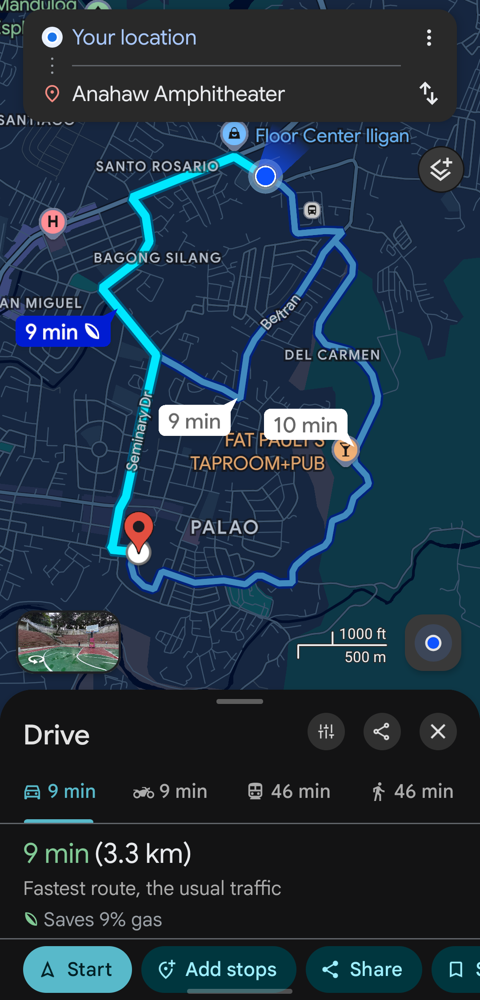

# Software in the Wild: Improving the Diyandi Experience Through Software

> **Name:** Smith, Yaseen P.  
> **Section:** CS3A  
> **Date submitted:** 2026-09-30

---

## 1. User group

**Who are you designing for?**  
PWDs, specifically mobility-impaired attendees such as wheelchair users, crutch/cane users, and individuals with limited stamina.

**Why might this group need support during Diyandi?**  
Diyandi transforms Iligan’s public spaces with massive crowds, street closures, and temporary structures. Navigating these crowded environments is physically exhausting and potentially dangerous for people with mobility challenges.

---

## 2. Situation or need

**What is this group trying to do during Diyandi?**  
These attendees want to participate in the festival, such as watching free concerts or visiting food stalls, by finding safe, step-free pathways, designated viewing areas, and accessible restrooms.

---

## 3. Problem or inconvenience

**What may make this task difficult, confusing, unsafe, slow, or inconvenient?**  
Based on my personal experience at the packed Anahaw Amphitheater during the Itchyworms concert, moving through venues is cramped and chaotic. Barricades set up near the stage for VIP or official areas often cut off the few flat ground-level pathways, and terraced seating requires climbing steep steps. Standard apps like Google Maps do not account for temporary fences, crowd bottlenecks, or lack of ramps, making it nearly impossible for mobility-impaired visitors to find safe viewing spots or emergency exits.

---

## 4. Proposed digital solution

**What digital tool would you propose?**  
Diyandi AccessMap, a lightweight, mobile-friendly web accessibility guide and navigation tool for festival venues.

**How would it help the intended users?**  
It highlights step-free pedestrian routes, verified ramp access, dedicated PWD viewing decks, and accessible portalets, allowing users to plan safe arrivals and avoid dead ends created by temporary crowd barricades.

---

## 5. Things users can do

Describe **two specific actions** that users could perform using your proposed system.

1. Check venue-specific accessibility layouts (such as Anahaw Amphitheater or City Plaza or Mugna) to locate flat-access entrances, ramp paths, and designated PWD viewing areas.
2. Submit real-time hazard or barrier reports (such as a locked gate, blocked ramp, or impassable crowd choke point) to alert fellow attendees and marshals.

---

## 6. Important qualities

Identify **two qualities** that would make your proposed system useful. You may consider whether it should be easy to use, fast, reliable, safe, private, accessible, multilingual, low-data, clear, or available during high demand.

### Quality 1: Reliability

**Why does this matter to users?**  
Inaccurate accessibility information can physically strand a wheelchair user on steep amphitheater stairs or trap them in a crowd crush. The mapped routes and gate statuses must be factually correct.

### Quality 2: Low-data consumption

**Why does this matter to users?**  
Mobile data networks severely slow down during peak events when thousands of attendees gather in one place. The web app must load quickly and cache maps locally with minimal bandwidth.

---

## 7. How to tell whether the solution helped

How could you determine whether your proposed solution actually helped users?

Gather direct feedback through a post-festival survey in partnership with Iligan’s Persons with Disability Affairs Office (PDAO) to determine whether attendees were able to find accessible viewing areas with less friction, and track how many reported venue bottlenecks were resolved by organizers.

---

## 8. Screenshot or reference

You may include **one screenshot** or reference image only if it does not contain personal, confidential, or sensitive information.

> Do not include passwords, private messages, account numbers, grades, addresses, personal information, or other confidential content.

**External sources used, if any:**  
None

---

## AI use declaration

Select **one** option below and complete the applicable details.

- 1 **AI tools used.** I used the following AI tool(s): Google Gemini.

  **Purpose of use:**  
  Evaluating my two initial project ideas (MSME stall directory vs. PWD accessibility route guide), critiquing my rough draft for Sections 1–7, and refining the text to ensure clarity and adherence to the 250–400 word count limit.

  **How I reviewed the output:**  
  I reviewed the generated suggestions to ensure they accurately reflected real conditions in Iligan during Diyandi (e.g., crowds at the Plaza and Anahaw, physical hazards like temporary street cables and missing curb cuts). I verified that the final wording matched my intended solution, selected qualities, and evaluation method before finalizing my file.

  **Prompt(s) or summary of interaction:**  
  I shared the activity instructions and rubric, then presented my two rough ideas (PWD accessibility navigation and an MSME food directory). After deciding on the PWD concept, I drafted my rough answers for items 1 through 7 and asked for a critique and consultation. The AI provided feedback on strengthening specific details (such as low-bandwidth design and local hazard reporting) and helped refine my draft into the required format.

> I understand that I remain responsible for the accuracy, originality, and quality of this submission. I confirm that I reviewed and revised any AI-generated content and can explain all ideas submitted under my name.

---

## Student declaration

I confirm that this work is based primarily on my own observation, experience, and reasoning. Any external sources or tools used have been acknowledged above.

**Name:** Smith, Yaseen P.
